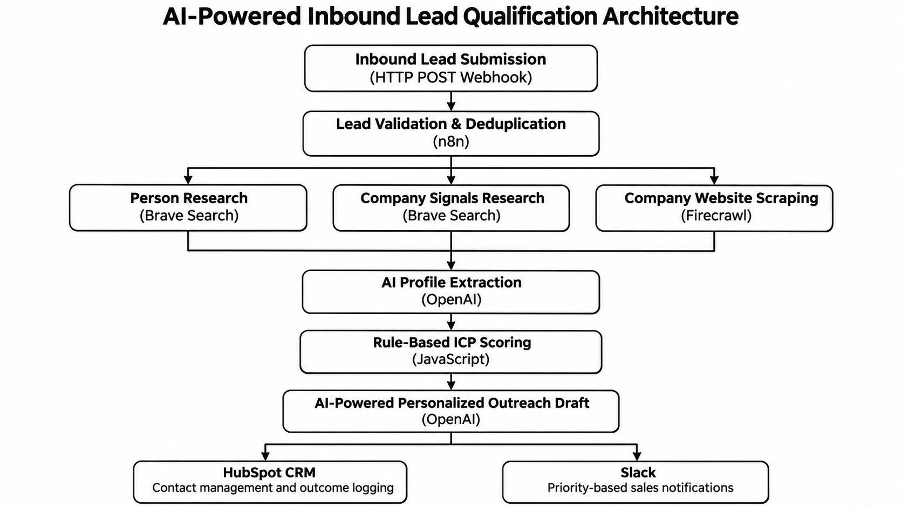
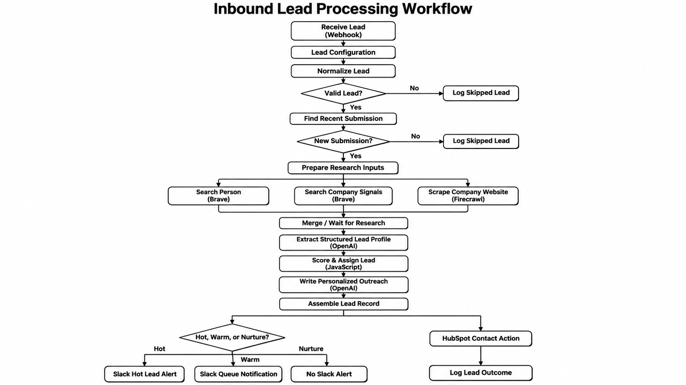
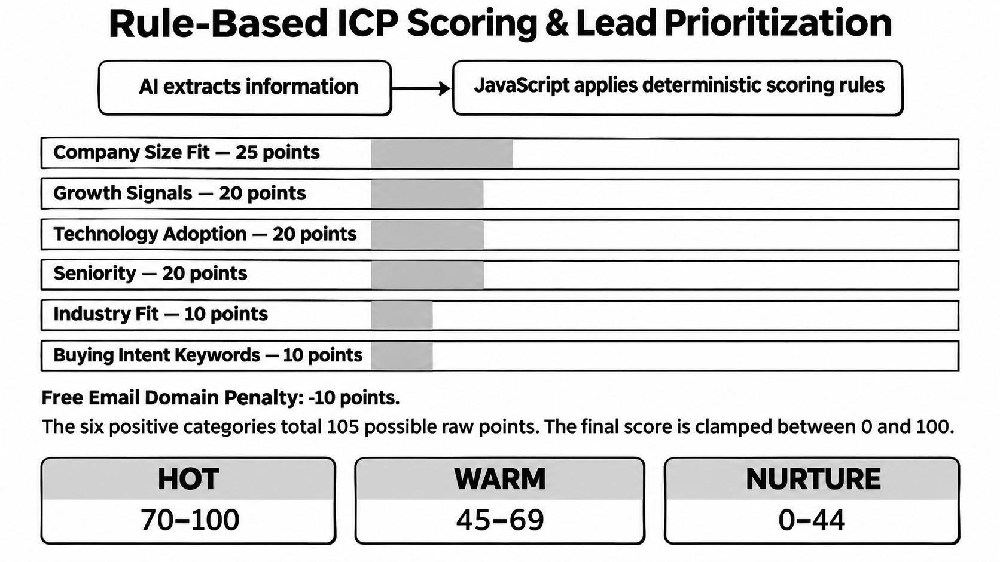
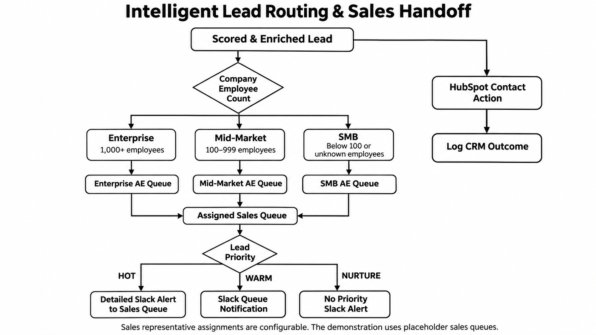

# AI-Powered Inbound Lead Qualification & Sales Routing Pipeline

An **n8n-based inbound GTM automation** that validates new inquiries, researches the person and company, generates a structured lead profile, scores ICP fit with transparent JavaScript rules, drafts a personalized first response, and routes the result to **HubSpot** and **Slack**.

**Tech stack:** n8n · JavaScript · Brave Search · Firecrawl · OpenAI · HubSpot · Slack · n8n Data Tables


## 1. Project Overview

An inbound lead might provide little more than an email address, name, and a short message. Before a sales representative can prioritize that inquiry, they often need to check the organization, identify buying signals, judge fit against the ideal customer profile (ICP), and prepare a relevant reply.

This project combines those steps in one n8n workflow. It uses web research and AI to **collect and structure evidence**, then uses explicit JavaScript logic to **make a repeatable scoring and routing decision**. It hands off the enriched record to HubSpot while sending priority-based Slack notifications on a separate branch.

## 2. Problem Statement

Inbound lead handling creates several repetitive tasks:

- Cleaning and validating inconsistent form submissions.
- Avoiding repeated qualification of the same email within a short window.
- Looking up a prospect's role and company growth or technology signals.
- Applying consistent ICP criteria across incoming inquiries.
- Deciding which sales queue should own the lead.
- Writing a relevant first response and recording context in the CRM.

**Objective:** Connect intake, research, deterministic qualification, personalized drafting, and sales handoff in one configurable workflow, without presenting AI-generated judgments as an opaque lead score.

## 3. Solution

The pipeline is organized into five stages:

1. **Intake and deduplication:** Normalize the webhook payload, validate the email, and check prior submissions in an n8n Data Table.
2. **Parallel enrichment:** Research the person and company with Brave Search and scrape the company website with Firecrawl.
3. **Structured AI extraction:** Use OpenAI to turn research results into a schema-constrained person and company profile, marking unsupported fields as unknown.
4. **Explainable qualification:** Use JavaScript to compute a weighted ICP score, apply a free-email penalty, classify the lead, and select a configurable sales queue.
5. **Sales handoff:** Draft a first reply, write contact details to HubSpot, log the outcome, and notify sales in Slack for hot or warm leads.

## 4. High-Level System Architecture



**Figure 1 — System architecture.** n8n orchestrates intake, independent research branches, AI profile extraction, deterministic scoring, outreach drafting, and parallel CRM/notification handoffs.

### Workflow logic



**Figure 2 — Detailed workflow logic.** The validation and duplicate decisions stop unsuitable submissions before research. HubSpot runs on a branch separate from Slack notifications.

### Step 1 — Webhook intake and validation

A `POST` request to the `inbound-lead` webhook starts the pipeline. The `Lead Config` node supplies the ICP criteria, score thresholds, deduplication window, free-email handling, and representative queues.

`Normalize Lead` standardizes email, names, company/domain, LinkedIn URL, phone, message, and source. A malformed or missing email is rejected. Free email addresses are **penalized by default, not blocked** (`block_free_email: false`). Skipped submissions are written to `inbound_leads_log` with the reason.

### Step 2 — Duplicate detection

`Find Recent Submission` checks the n8n Data Table by email. The `Is New Lead` decision rejects repeat submissions within the configured **24-hour** window; older submissions are allowed to continue. This is a time-window check, not a claim of organization-wide identity resolution.

### Step 3 — Parallel research

After preparing the search queries, the workflow starts three branches:

| Operation | Integration | Research target |
| --- | --- | --- |
| Search Person | Brave Search | Prospect identity, role, and professional context |
| Search Company Signals | Brave Search | Funding, hiring, employee count, and growth signals |
| Scrape Company Website | Firecrawl | Company website content and product context |

A three-input merge waits for the research branches. Results are supplied to `Extract Lead Profile` as context; the merge does not itself infer attributes.

### Step 4 — Structured AI profile

The OpenAI step requests a strict JSON-schema response containing, among other fields, industry, employee count, headquarters, funding stage, growth evidence, technology stack, seniority, tenure, personalization hooks, and confidence.

The extraction prompt explicitly asks for **unknown or empty values when evidence is missing**, rather than fabricated facts. Employee count can still be an estimate when the source gives a range; confidence is a qualitative field, not a calibrated probability.

### Step 5 — Score and assign

The `Score & Assign Lead` JavaScript node reads the profile, applies configured weights, produces `score_breakdown`, classifies the lead, and assigns the segment queue. **The LLM does not set the final ICP score or priority tier.**

### Step 6 — Draft, sync, and notify

A second OpenAI step prepares a short email subject, a first-response message, a LinkedIn connection note, and a personalization hook. Its prompt limits the email body to **110 words** and the LinkedIn note to **280 characters**. A fallback message is prepared if the model output cannot be parsed.

`Assemble Lead Record` then feeds two separate branches:

- **Slack:** Detailed hot-lead alerts, shorter warm-lead queue notifications, and no priority alert for nurture leads.
- **HubSpot:** A contact action followed by an n8n Data Table log of sync status, contact ID (when returned), error, and processing duration.

A drafted message is provided to sales for review; no automatic outbound send is configured.

## 5. Rule-Based ICP Scoring



**Figure 3 — Explainable ICP scoring.** Maximum point allocations and priority thresholds are taken from the JavaScript node, not inferred from model output.

| Scoring factor | Maximum points | Rule summary |
| --- | ---: | --- |
| Company size fit | 25 | Full points inside the configured 50–2,000 employee ICP range; partial points outside it |
| Growth signals | 20 | High / medium / low evidence maps to 20 / 10 / 2 |
| Technology adoption | 20 | Adoption level contributes up to 15, with 5 more for a matching target technology |
| Seniority | 20 | C-level, VP, director, manager, and IC receive different fixed points |
| Industry fit | 10 | Match against configured target industries |
| Buying intent keywords | 10 | Keyword match in the submitted message |
| Free email domain | **−10** | Penalty for a configured public email domain |

The positive categories can sum to **105 raw points**. After penalties, JavaScript rounds and clamps the score to the **0–100** range.

| Priority | Score | Routing outcome |
| --- | --- | --- |
| **HOT** | 70–100 | Detailed Slack alert and CRM contact processing |
| **WARM** | 45–69 | Slack queue notification and CRM contact processing |
| **NURTURE** | 0–44 | No priority Slack alert; CRM contact processing continues |

The workflow stores a breakdown such as `size 25, growth 10, tech 13, seniority 15, industry 10, intent 0`, making each category's contribution inspectable. These are **heuristic rules**, not a trained or statistically validated conversion-probability model.

## 6. Sales Routing and CRM Handoff



**Figure 4 — Sales routing and CRM handoff.** A lead's employee count determines its sales queue, while the score determines the Slack notification level. HubSpot contact processing is independent of Slack notification routing.

| Company size | Assigned segment |
| --- | --- |
| 1,000+ employees | Enterprise AE queue |
| 100–999 employees | Mid-Market AE queue |
| Below 100, or unknown | SMB AE queue |

The `reps` configuration contains placeholder Enterprise, Mid-Market, and SMB assignments. If a Slack member ID is supplied, the hot-lead alert can mention that representative; otherwise it displays the configured name.

HubSpot contact fields include name, email, company, job title, industry, company size, LinkedIn URL, phone, website, and lifecycle stage. The workflow also places the score, score breakdown, signals, and proposed opener in the mapped contact message field.

**Configured lifecycle mapping:** HOT → Sales Qualified Lead; WARM → Marketing Qualified Lead; NURTURE → Lead. This uses HubSpot's standard lifecycle stage values unless customized in the destination account.

## 7. System Integrations

| Technology | Responsibility |
| --- | --- |
| **n8n** | Orchestration, branching, data transformations, webhook, and logging |
| **JavaScript (n8n Code)** | Input normalization, deterministic scoring, segment assignment, fallback assembly |
| **Brave Search** | Person and company signal research |
| **Firecrawl** | Website scraping |
| **OpenAI** | Structured profile extraction and personalized draft generation |
| **HubSpot CRM** | Contact processing and lifecycle-stage handoff |
| **Slack** | Priority-dependent sales notifications |
| **n8n Data Tables** | Deduplication lookup, skipped-submission logs, and processing outcomes |

The supplied export selects `gpt-5.4-mini` for both OpenAI nodes. API-provider availability and credential setup depend on the n8n environment; the provided workflow references gateway-managed credentials for research and AI nodes.

## 8. Key Technical Design Decisions

### A. AI for extraction, code for decisions

Public websites and search results are unstructured and inconsistently formatted. The AI step synthesizes their evidence into a constrained schema; JavaScript independently handles weights, thresholds, and assignment. **Why:** Avoid having the model invent or inconsistently apply lead-priority criteria.

### B. Separate person, company, and website research

Three research branches gather complementary evidence. **Why:** A company website alone may not contain personal career history or recent growth activity; combining sources offers broader research context. The workflow does not guarantee that every source will return useful information.

### C. Early validation and deduplication

Invalid emails and recent repeat submissions are logged before external research. **Why:** Reduce avoidable processing and repeated outreach preparation. No quantified cost or time savings have been measured.

### D. Confidence-aware personalization

The outreach prompt prefers specific, verifiable hooks; if extraction confidence is low or failed, it restricts personalization to the submitted message and company. **Why:** Reduce the risk of sales representatives relying on unsupported personal claims.

### E. Independent CRM and Slack branches

CRM handling is not downstream of the hot/warm Slack switch. **Why:** Nurture leads still need a CRM record, and Slack notification eligibility should not determine whether the CRM branch is reached.

### F. Failure-aware workflow steps

Research and AI nodes have configured retries and continue-on-error behavior; the HubSpot action records an error-dependent status through the subsequent log node. **Why:** Make external-service failures observable and allow downstream steps to use available fallback data where possible. This is not a guarantee of successful processing in every failure mode.

## 9. Input and Output Contract

The production endpoint is the n8n-generated URL for the `inbound-lead` path. A representative JSON payload is:

```json
{
  "email": "alex@example.com",
  "first_name": "Alex",
  "last_name": "Morgan",
  "company": "Example Software",
  "website": "https://example.com",
  "job_title": "Head of Operations",
  "message": "Interested in a demo and pricing information.",
  "source": "website"
}
```

**Required field:** `email` (syntactically valid). Supported optional fields include `name` or first/last name, company, website, job title, LinkedIn URL, phone, country, message, and source. The normalizer also recognizes a few common field aliases.

**Outputs** include the normalized record, structured profile, ICP score and breakdown, priority tier, owner queue, suggested outreach, HubSpot contact result, and an n8n Data Table processing log. Invalid or duplicate submissions are logged as skipped.

The webhook is configured to return `{"status":"received"}`. This response acknowledges receipt; it should not be interpreted as confirmation that enrichment and CRM sync have succeeded.

## 10. Configuration and Setup

1. **Import and inspect the workflow** in n8n. Rebind your own credentials and n8n Data Table; the export contains environment-specific references that will not automatically work in another instance.
2. **Connect services:** Slack (permission to post to a channel), HubSpot (contact access), and the research/AI providers required by your n8n environment. The original demo uses gateway-managed research/AI credentials.
3. **Configure `Lead Config`:** Change `company_pitch` to what your business actually sells. Set target industries/technologies, ICP employee bounds, tier thresholds, dedupe window, public-email policy, and representative assignments.
4. **Review JavaScript scoring weights:** They live in `Score & Assign Lead`, not solely in `Lead Config`.
5. **Select Slack channels:** Configure `Alert Rep - Hot Lead` and `Notify Queue - Warm Lead` for your workspace. The provided export points both to a demonstration channel.
6. **Check HubSpot mappings:** The workflow uses standard contact properties. Verify lifecycle-stage values and the message field against your portal.
7. **Test the `POST` webhook** with a sample payload. Inspect the output of each research node, the generated profile, `score_breakdown`, Slack notifications, HubSpot record, and `inbound_leads_log` before activating the production webhook.

The demonstration configuration uses a pitch referencing ITONICS as an example only. It is **not** evidence of an integration, employment relationship, endorsement, or partnership with ITONICS.

### Default configuration

| Setting | Exported value |
| --- | --- |
| ICP employee size | 50–2,000 |
| HOT threshold | 70 |
| WARM threshold | 45 |
| Deduplication window | 24 hours |
| Block free email domains | `false` |
| Segment cutoffs | Enterprise ≥1,000; Mid-Market ≥100; SMB otherwise |


## Run This Workflow in n8n

**[View Interactive n8n Workflow](https://share-n8n.com/shared/KB6C4GqKKnUv)** | **[Download Workflow JSON](./workflow.json)**

### Setup Instructions

1. **Import the workflow:** Open n8n → Create Workflow → Three-dot menu → Import from File → Select `workflow.json`.

2. **Connect credentials:** Configure Brave Search, Firecrawl, OpenAI, HubSpot, and Slack.

3. **Create the Data Table:** Create `inbound_leads_log` with the required columns and select it in the three Data Table nodes.

4. **Configure your ICP:** Open the `Lead Config` node and update:
   - Company pitch
   - Target industries and technologies
   - Ideal company size
   - Hot and warm scoring thresholds
   - Sales representative assignments

5. **Configure integrations:** Select your Slack notification channels and verify HubSpot contact mappings.

6. **Test the workflow:** Click **Listen for Test Event** on the webhook node and send a sample POST request:

   ```bash
   curl -X POST "https://YOUR-N8N-DOMAIN/webhook-test/inbound-lead" \
     -H "Content-Type: application/json" \
     -d '{
       "first_name": "Alex",
       "last_name": "Morgan",
       "email": "alex@example.com",
       "company": "Example Inc",
       "website": "example.com",
       "job_title": "Head of Sales",
       "message": "Interested in a product demo"
     }'
   ```

7. **Verify outputs:** Check the lead score, HubSpot contact, Slack notification, and execution logs.

8. **Go live:** Publish the workflow and use the production webhook:

   ```text
   https://YOUR-N8N-DOMAIN/webhook/inbound-lead
   ```

> **Note:** This workflow uses demonstration ICP settings and placeholder sales queues. Update these before production use. API credentials must be configured in your own n8n instance.


---

**Project focus:** GTM Engineering · Inbound Lead Qualification · Workflow Automation · AI-Assisted Enrichment · Explainable ICP Scoring · Lead Routing · CRM Integration · Sales Enablement
