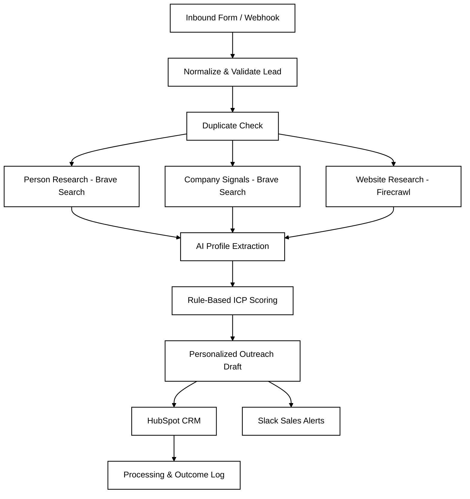
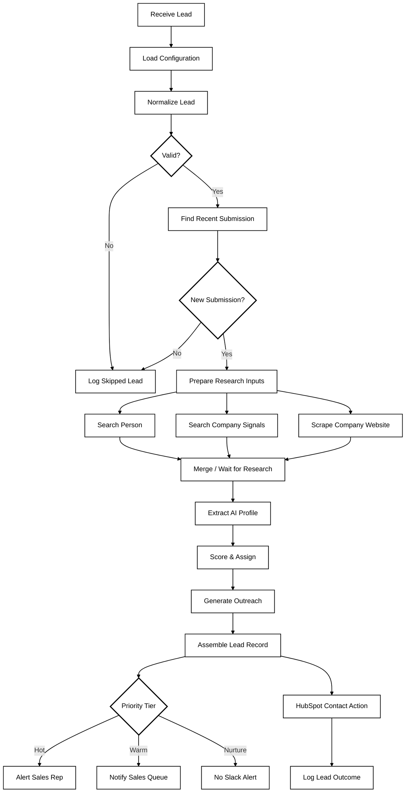
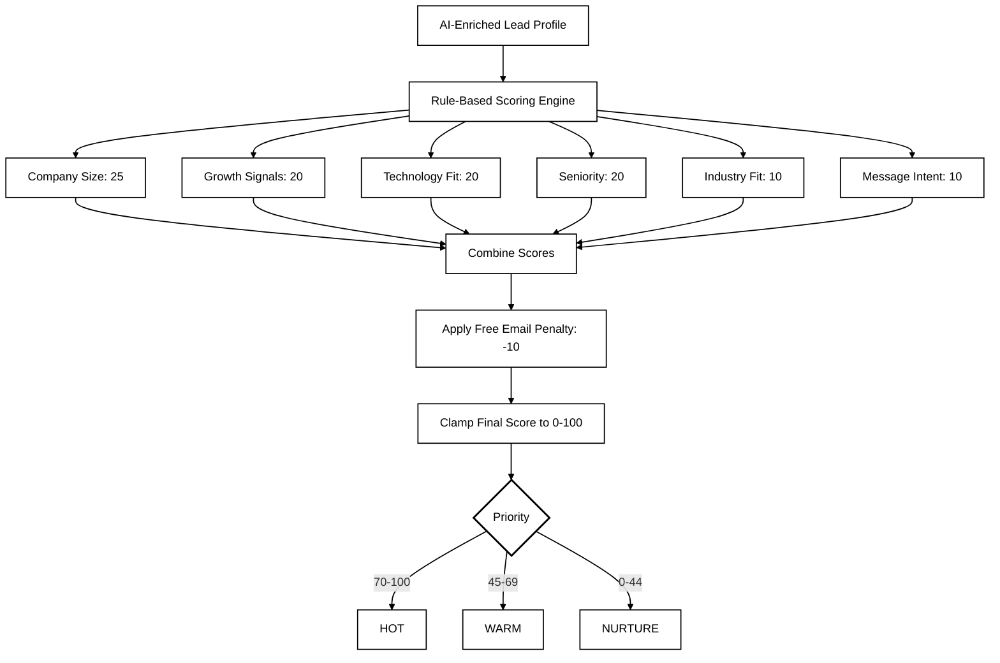
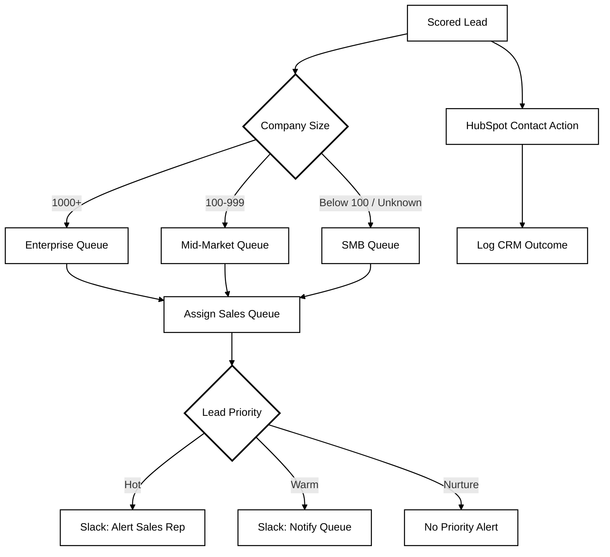

# AI-Powered Inbound Lead Qualification & Sales Routing

An end-to-end **n8n workflow** for validating inbound leads, enriching contact and company information, scoring prospects against an Ideal Customer Profile (ICP), generating personalized follow-up suggestions, and routing qualified leads to sales teams through **HubSpot and Slack**.

**Built with:** n8n · Brave Search · Firecrawl · OpenAI · JavaScript · HubSpot · Slack

**[View Live Workflow](https://share-n8n.com/shared/KB6C4GqKKnUv) **

> **Project status:** Workflow implementation / demonstration. This repository documents the exported workflow configuration. Full production reliability and end-to-end execution metrics have not been independently verified.

---

## 1. The Problem

When a potential customer submits an inbound form, sales teams often need to manually:

- Validate the lead's contact details.
- Check for duplicate submissions.
- Research the person and their company.
- Determine whether the company fits the ICP.
- Identify relevant growth and buying signals.
- Decide which salesperson should follow up.
- Prepare personalized outreach.
- Enter the information into the CRM.

These repetitive tasks create delays between lead submission and sales follow-up.

### The Solution

I developed an automated inbound lead qualification workflow using **n8n**.

The system accepts incoming lead data, validates and deduplicates it, researches the contact and company, creates a structured AI-generated profile, scores the lead using configurable rules, and prepares the information for sales follow-up.

---

## 2. System Architecture

The system is organized into four stages:

1. **Lead Intake:** Receive, normalize, validate, and deduplicate submissions.
2. **Research:** Collect information from public search results and company websites.
3. **Qualification:** Extract structured information, calculate an ICP score, and generate outreach suggestions.
4. **Sales Handoff:** Route alerts through Slack, synchronize contact information with HubSpot, and log outcomes.

### Figure 1 - High-Level System Architecture



**Architecture overview:** n8n orchestrates the workflow, while external services provide research, AI processing, CRM management, and team notifications.

---

## 3. Detailed Workflow

### Stage 1 - Lead Intake and Validation

A lead enters the workflow through an HTTP POST webhook.

The normalization logic processes fields such as:

- First name and last name
- Business email
- Company name and website
- Job title
- LinkedIn profile
- Phone number
- Country
- Submitted message
- Lead source

The workflow performs basic email-format validation, standardizes fields, identifies free email domains, and checks recent submissions.

The duplicate-detection window is configurable and defaults to **24 hours**.

Invalid leads and detected duplicates are directed to a skipped-lead logging action.

### Stage 2 - Lead Research and Enrichment

The workflow gathers information from three research sources:

| Research source | Purpose |
|---|---|
| Brave Search - Person | Research the lead's professional background and role |
| Brave Search - Company | Identify public company information and growth signals |
| Firecrawl | Extract information from the company website |

The research results are passed to an OpenAI model that generates a structured profile.

The extracted fields include company size, industry, growth signals, technology adoption, seniority, relevant career information, and potential personalization hooks.

The AI is instructed not to invent unsupported facts and to return unknown values when information is unavailable.

### Stage 3 - Qualification and Personalization

JavaScript scoring logic evaluates the structured profile against configured ICP criteria.

The system then:

- Calculates a lead score.
- Assigns a Hot, Warm, or Nurture tier.
- Selects a sales queue based on company size.
- Generates a suggested email reply.
- Generates a LinkedIn connection note.
- Records the scoring breakdown and research confidence.

### Stage 4 - Sales Handoff

The workflow branches based on lead priority.

- **Hot leads:** Detailed Slack notification with suggested outreach.
- **Warm leads:** Slack queue notification.
- **Nurture leads:** No priority Slack notification in the supplied configuration.

A parallel branch sends contact data to HubSpot and records the result in the n8n data table.

### Figure 2 - Detailed Workflow Logic



**Note:** The HubSpot and Slack branches execute independently after record assembly. The diagram reflects the configured node connections rather than confirmed execution results.

---

## 4. Explainable Lead Scoring

Instead of allowing an LLM to assign an arbitrary score, the pipeline separates **AI research** from **rule-based scoring**.

The AI extracts structured information, and JavaScript applies the scoring rules.

### Scoring dimensions

| Dimension | Maximum points | Evaluation |
|---|---:|---|
| Company size | 25 | Fit against configured employee range |
| Growth signals | 20 | Funding, hiring, expansion, and growth evidence |
| Technology adoption | 20 | Adoption level and matching technologies |
| Seniority | 20 | C-level, VP, Director, Manager, or IC |
| Industry fit | 10 | Match against configured target industries |
| Message intent | 10 | Relevant intent keywords in submitted message |
| Free email penalty | -10 | Applied to free email domains |

The positive dimensions total 105 possible raw points. The final score is capped at 100 and cannot fall below zero.

### Lead Priority Thresholds

| Tier | Score | HubSpot lifecycle mapping |
|---|---|---|
| Hot | 70–100 | Sales Qualified Lead |
| Warm | 45–69 | Marketing Qualified Lead |
| Nurture | 0–44 | Lead |

These thresholds can be modified in the workflow's `Lead Config` node.

### Figure 3 - Lead Scoring Model



### Why Rule-Based Scoring?

- **Explainability:** Every score has an identifiable breakdown.
- **Consistency:** The same input criteria follow the same scoring rules.
- **Configurability:** Business-specific thresholds can be changed.
- **Auditability:** The score breakdown can be inspected by sales operations.

**Limitation:** The scoring model is a heuristic. Its ability to predict real sales conversion would need to be validated using actual pipeline outcomes.

---

## 5. Sales Routing and CRM Integration

After qualification, the workflow determines the appropriate sales queue based on company size.

### Account Segmentation

| Segment | Employee count | Sales queue |
|---|---|---|
| Enterprise | 1,000+ | Enterprise AE |
| Mid-Market | 100–999 | Mid-Market AE |
| SMB | Below 100 or unknown | SMB AE |

The workflow supports configurable sales representative details.

In the supplied export, the representative names are placeholders and Slack member IDs are not populated.

### HubSpot Integration

The configured HubSpot action maps fields including:

- Email and name
- Company and website
- Job title and industry
- Company size
- LinkedIn profile and phone
- Lifecycle stage
- Original message
- Lead scoring details
- Suggested outreach text

**Implementation note:** The node is labeled `Upsert HubSpot Contact`, but the exported configuration does not independently confirm a search-before-create or true upsert operation. Existing-record behavior should be verified before deploying the workflow.

### Slack Integration

The workflow contains two types of priority notifications.

**Hot lead alert**

Includes the lead's score, relevant company information, contact details, available signals, score breakdown, and suggested outreach.

**Warm lead notification**

Includes the lead's score, company information, assigned queue, scoring reasons, and suggested outreach subject.

### Figure 4 - Priority-Based Sales Routing



---

## 6. Technology Stack

| Tool | Role | Website |
|---|---|---|
| n8n | Workflow automation and orchestration | [n8n](https://n8n.io/) |
| Brave Search | Person and company research | [Brave Search API](https://brave.com/search/api/) |
| Firecrawl | Website content extraction | [Firecrawl](https://www.firecrawl.dev/) |
| OpenAI | Structured AI analysis and outreach drafts | [OpenAI API](https://platform.openai.com/docs/overview) |
| JavaScript | Normalization, scoring, and routing logic | [MDN JavaScript](https://developer.mozilla.org/en-US/docs/Web/JavaScript) |
| HubSpot | CRM contact management | [HubSpot](https://www.hubspot.com/) |
| Slack | Sales notifications | [Slack](https://slack.com/) |

The workflow export references `gpt-5.4-mini` for AI processing. Model availability and credentials must be checked in the target n8n environment.

---

## 7. Configuration and Setup

### Prerequisites

- An n8n instance supporting the required nodes.
- Access to Brave Search, Firecrawl, and OpenAI integrations.
- HubSpot account with contact permissions.
- Slack workspace with permission to post messages.
- An n8n data table for workflow logging.

### Step 1 - Import the workflow

Import the sanitized workflow JSON into n8n.

You can also inspect the shared workflow:

[View the n8n workflow](https://share-n8n.com/shared/KB6C4GqKKnUv)

### Step 2 - Configure `Lead Config`

Update the following values:

| Variable | Demo configuration |
|---|---|
| `company_pitch` | Replace the Itonics demonstration placeholder |
| `target_industries` | Software, SaaS, fintech, e-commerce, marketing, IT services |
| `target_tech` | HubSpot, Salesforce, Segment, Snowflake, AWS, Stripe, Shopify, Zapier, n8n |
| `icp_min_employees` | 50 |
| `icp_max_employees` | 2,000 |
| `hot_threshold` | 70 |
| `warm_threshold` | 45 |
| `dedupe_hours` | 24 |
| `block_free_email` | false |

The company pitch and ICP settings are demonstration defaults, not requirements for all businesses.

### Step 3 - Connect External Services

Configure the authentication and permissions for the tools used in the workflow.

Update the Slack channel IDs, HubSpot credentials, and research service connections to match your own environment.

### Step 4 - Configure the Data Table

Create or select the required n8n data table and map the fields used by the logging and duplicate-check nodes.

The exported workflow references a table named `inbound_leads_log`. Its original instance-specific ID must not be assumed to exist in another environment.

### Step 5 - Test the Webhook

The workflow accepts JSON over HTTP POST at the configured `inbound-lead` webhook path.

Example payload using fictional information:

```json
{
  "first_name": "Alex",
  "last_name": "Morgan",
  "email": "alex@example.com",
  "company": "Example Company",
  "website": "example.com",
  "job_title": "Head of Operations",
  "country": "Germany",
  "message": "Interested in learning more about the platform.",
  "source": "website"
}
```

Use the webhook URL generated by your own n8n instance. The payload above is illustrative test data, not a recorded successful execution.

### Step 6 - Validate Outputs

Test the workflow with synthetic data before connecting real leads.

Recommended checks:

1. Valid lead accepted.
2. Invalid email rejected.
3. Duplicate submitted within the configured window.
4. Lead with missing company information.
5. Failed or incomplete research response.
6. Hot, Warm, and Nurture tier assignments.
7. CRM errors and retry behavior.
8. Slack alert content and destination.
9. Accurate processing and error logs.

---

## 8. Key Engineering Decisions

### Structured AI Outputs

The AI profile extraction node uses a defined JSON schema, allowing subsequent nodes to consume consistent fields.

### Deterministic Scoring

Business rules calculate lead scores separately from AI research, making qualification decisions easier to inspect and change.

### Research Confidence

The workflow records enrichment confidence and instructs the outreach model to avoid unsupported personalization when research quality is low.

### Modular Workflow Design

The pipeline separates intake, research, scoring, messaging, and CRM delivery so that different parts can be developed and tested independently.

### Fallback Handling

The workflow includes retry configurations for several external service nodes and a fallback outreach draft if the AI-generated message cannot be parsed.

---

## 9. Limitations and Future Improvements

This project is a workflow implementation and demonstration rather than a verified production-scale revenue system.

Current limitations and suggested improvements include:

- Verify the actual HubSpot create/update behavior.
- Test duplicate-detection reliability, especially when matching records are absent.
- Validate research merging and synchronization behavior.
- Confirm that failed external API calls are consistently detected and logged.
- Replace demonstration sales queue placeholders with actual user assignments.
- Store structured scoring data in dedicated CRM properties where appropriate.
- Evaluate lead scoring thresholds using historical sales outcomes.
- Add explicit review before any automated outbound communication.
- Add privacy, consent, retention, and access controls appropriate to the deployment.

No production conversion-rate improvement or speed-to-lead performance claim is made without measured evidence.

---

## 10. Related Projects

### [Lead Enrichment & Outreach Pipeline](https://github.com/riyazmullaji/Lead-Enrichment-Outreach-Pipeline)

Clay-based prospect research, decision-maker identification, waterfall enrichment, email validation, and outbound campaign preparation.

### [AI Venture Deal Screening System](https://github.com/riyazmullaji/AI-Venture-Deal-Screening-System)

Multi-agent AI workflow for startup evaluation, competitor research, market sizing, and preliminary investment screening.

---

## Author

**Riyaz Sameer Mullaji**

M.Sc. Human & Artificial Intelligence  
University of Technology Nuremberg, Germany

[GitHub](https://github.com/riyazmullaji) · [LinkedIn](https://www.linkedin.com/in/riyazmullaji)

---

*Built as a practical exploration of AI-assisted revenue operations, inbound lead intelligence, workflow automation, and sales process orchestration.*
